<pre><picture><source media="(max-width: 1000px)" srcset="assets/terminal/terminal-top-compact.svg" /></picture>
<a href="https://kunalavghade.github.io"><picture><source media="(max-width: 1000px)" srcset="assets/terminal/terminal-link-portfolio-compact.svg" /></picture></a><a href="https://www.linkedin.com/in/kunalavghade/"><picture><source media="(max-width: 1000px)" srcset="assets/terminal/terminal-link-linkedin-compact.svg" /></picture></a><a href="https://leetcode.com/u/akunal/"><picture><source media="(max-width: 1000px)" srcset="assets/terminal/terminal-link-leetcode-compact.svg" /></picture></a><a href="https://github.com/kunalavghade/TrainMesh"><picture><source media="(max-width: 1000px)" srcset="assets/terminal/terminal-link-trainmesh-compact.svg" /></picture></a><a href="https://kunalavghade.github.io/kubelab/"><picture><source media="(max-width: 1000px)" srcset="assets/terminal/terminal-link-kubelab-compact.svg" /></picture></a><a href="https://kunalavghade.github.io/dockerlab/"><picture><source media="(max-width: 1000px)" srcset="assets/terminal/terminal-link-dockerlab-compact.svg" /></picture></a><a href="https://github.com/kunalavghade/PixelBeats"><picture><source media="(max-width: 1000px)" srcset="assets/terminal/terminal-link-pixelbeats-compact.svg" /></picture></a>
<picture><source media="(max-width: 1000px)" srcset="assets/terminal/terminal-fetch-compact.svg" /></picture>
</pre>

---

| Languages | Streak |
| :-- | :-- |
|  |  |

---

  

---

  

